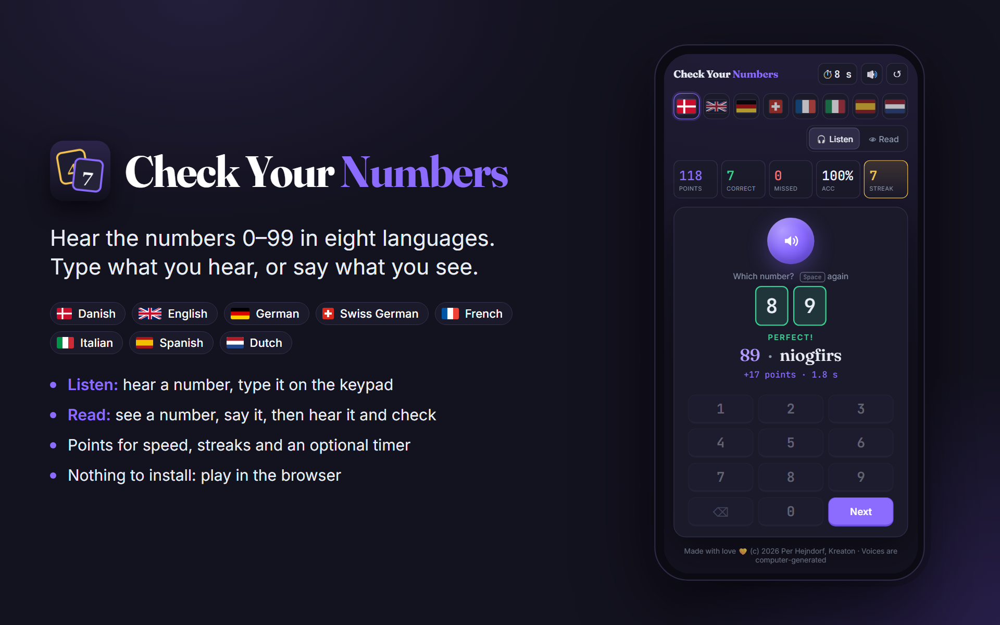

# Check Your Numbers

[](https://kreaton.github.io/CheckYourNumbers/)
[](LICENSE)


[](https://github.com/kreaton/CheckYourNumbers/stargazers)

⭐ If Check Your Numbers earns a place on your machine, [star it on GitHub](https://github.com/kreaton/CheckYourNumbers) — it's free, made by one developer, and stars are how other people find it.



**Hear and say the numbers 0–99 in Danish, English, German, Swiss German, French, Italian, Spanish and Dutch.**

**Play it: <https://kreaton.github.io/CheckYourNumbers/>**

A sibling of [Check Your Nouns](https://github.com/kreaton/CheckYourNouns), built from three older
apps: *Danske tal*, *English Numbers* and *Imperare Italiano*. One app, a language picker, and the
original recordings, plus new ones for German, Swiss German, French and Spanish.

*Swiss German* is Swiss Standard German: a Swiss voice saying the standard German numbers, written
the Swiss way without ß (*dreissig*). Its code and folder are `ch`.

## How it works

Pick a language and a mode.

- **Listen 🎧:** a number is spoken; type it on the keypad (or your own keyboard). Two digits are
  checked straight away, a single digit with ✓ or `Enter`.
- **Read 👁:** a number is shown; say it out loud, then reveal it to hear and see it, and grade
  yourself.

- A wrong answer buzzes and plays the recording again, so you hear what it should have been. The
  answer is shown with the number written out: *47 · syvogfyrre*, *23 · ventitré*.
- `Space` plays the recording again.
- Numbers come in random order, and every one is shown once before any repeats.
- Score, accuracy and streak are kept in the browser for each language and mode; ↺ resets them.

### Timer

Pick **Off** or 3–15 seconds under ⏱ (a new setting starts with the next round).

- **Listen:** running out of time counts the round as missed.
- **Read:** the answer reveals itself when the time is up. This is the old apps' "seconds between
  question and answer" setting.

### Points

A right Listen answer scores **10 points**, plus a **speed bonus** of up to 10 more that shrinks to
nothing at the time limit (without a timer, at 6 seconds). A self-graded *Got it* in Read mode scores 10.

## Adding a language

The app shows every language in [`Game/Language.cs`](CheckYourNumbers/Game/Language.cs) that has
recordings. A new language needs:

1. Its numbers written out, as a function in `NumberWords.cs`.
2. The recordings in `CheckYourNumbers/wwwroot/audio/<code>/numbers/`, named `0.mp3` … `99.mp3`.
3. An entry in `Language.cs` with `NumberAudio = "mp3"`.

## Making recordings

`tools/tts` holds what made the German, Swiss German, French and Spanish recordings with
[edge-tts](https://github.com/rany2/edge-tts) (`pip install edge-tts`):

- `numbers.txt`: the digits 0–99, one per line. The voice reads each one in its own language, and
  the file is named after the line, so `47` becomes `47.mp3`.
- `WordsToMp3.py`: turns each line of a text file into an mp3 with the given voice, skipping files
  that already exist.
- `WordsToMp3.bat`: runs it for French (`fr-FR-DeniseNeural`), Spanish (`es-ES-ElviraNeural`),
  German (`de-DE-AmalaNeural`) and Swiss German (`de-CH-LeniNeural`) into
  `tools/tts/audio/<code>/numbers` (not committed), from where the files are copied to
  `CheckYourNumbers/wwwroot/audio`.
- `words-de.txt`, `words-es.txt`, `words-fr.txt`: the same numbers written out, as the app shows
  them, should a voice ever read a digit wrong.

The game engine can also play a word list (`Language.Words`), with the recordings in
`audio/<code>/words/`; no language has one at the moment.

## Audio

All recordings are synthetic speech from Microsoft neural voices, so the footer says that the
voices are computer-generated.

| Folder | Files | Made with |
|---|---|---|
| `audio/da/numbers` | 0–99, mp3 | Azure AI Speech, for *Danske tal* |
| `audio/en/numbers` | 0–99, mp3 | Azure AI Speech, for *English Numbers* |
| `audio/it/numbers` | 0–99, wav | Azure AI Speech, for *Inumeri* (the Italian forerunner of the two above) |
| `audio/nl/numbers` | 0–99, mp3 | Azure AI Speech, with the same generator |
| `audio/de/numbers` | 0–99, mp3 | edge-tts, `de-DE-AmalaNeural` |
| `audio/ch/numbers` | 0–99, mp3 | edge-tts, `de-CH-LeniNeural` |
| `audio/fr/numbers` | 0–99, mp3 | edge-tts, `fr-FR-DeniseNeural` |
| `audio/es/numbers` | 0–99, mp3 | edge-tts, `es-ES-ElviraNeural` |

The Italian numbers are still WAV files as they were made; they could be converted to MP3 to save
about 3 MB.

## Run

```bash
dotnet run --project CheckYourNumbers
```

The app then runs at http://localhost:5153.

## Icons

The app icon (iOS home screen, Windows/Android install via the web app manifest, and the browser
favicon) is drawn by a script into `CheckYourNumbers/wwwroot/icons` and `wwwroot/favicon.ico`:

```powershell
powershell -File tools\make-icons.ps1
```

The README banner (`images/banner.png`) is `tools/banner.html` rendered by headless Edge. Its phone
is `tools/banner-phone.html`: the app's own markup and stylesheet after a right answer.

```powershell
powershell -File tools\make-banner.ps1
```

## Version

`Directory.Build.props` sets the version: Major.Minor by hand, and the patch is the GitHub Actions
run number (0 for local builds). The footer shows the version, build time and git commit.

## Deploy

`.github/workflows/deploy.yml` publishes to [GitHub Pages](https://kreaton.github.io/CheckYourNumbers/) on every push to `main` (or manually from
the Actions tab). The page uses a relative `<base href="./">`, so it works in any folder.

## License & Authorship

This project is distributed under the terms of the [MIT License](LICENSE), except the recordings;
see [THIRD-PARTY-NOTICES.md](THIRD-PARTY-NOTICES.md).

**AI authorship note:** Most of the source code in this repository was generated with AI coding agents (Claude Code), under my direction and review. Purely AI-generated material may not be eligible for copyright protection in some jurisdictions. To the extent any part of this project is protected by copyright, it is licensed under the MIT License, and the license's warranty and liability disclaimers apply to the project as a whole.

<!-- notices:start -->
### Independent development

CheckYourNumbers is an independent, personal project developed by Per Hejndorf. It is not affiliated with, endorsed by or sponsored by Microsoft or any other rights holder (including Google). Product names and logos are trademarks of their respective owners and are used only to identify the services and tools the project works with.

### Third-party notices and asset provenance

[THIRD-PARTY-NOTICES.md](THIRD-PARTY-NOTICES.md) lists every third-party library, font and online service the project uses, with version, licence, source and whether it was modified. It also records where the icons, images, audio and video came from and how they are licensed.
<!-- notices:end -->
